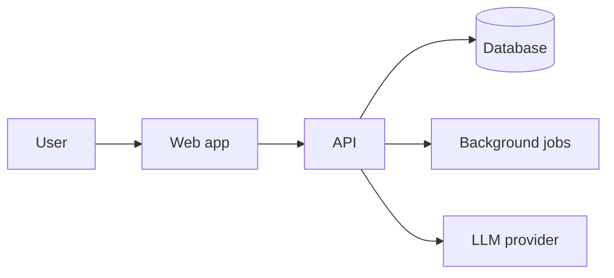

# Architecture — __PROJECT_NAME__

## Overview

<!-- Two or three sentences: what the system is made of and how a request flows through it. -->

## Components

| Component | Responsibility | Tech | Lives in |
|---|---|---|---|
| | | | |

## Boundaries

<!-- What may import or call what. Enforce in lint (dependency-cruiser or ESLint import rules) once the layout settles. -->

- UI never talks to the database directly.
-

## Key flows

<!-- The 2–4 flows that matter most (sign-up, the core action, billing). Short numbered steps each. -->

## External integrations

| Service | Used for | Data sent | Auth | Failure behaviour |
|---|---|---|---|---|
| | | | | |

Editing this section makes CI require a matching update to `SECURITY.md` and `docs/legal/SUBPROCESSORS.md`.

## Environments

| Env | Branch | URL | Notes |
|---|---|---|---|
| Local | any | localhost | |
| Staging | `staging` | | Agent PRs merge here |
| Production | `main` | | |

## Constraints and invariants

<!-- Things that must always hold. Reviewers check these; tests should too. -->

- Every query is scoped to the current tenant.
- Money is integer minor units plus a currency code (see CONVENTIONS.md).
-
