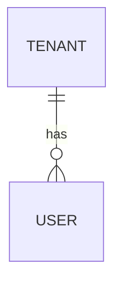

# Schema — __PROJECT_NAME__

The migrations are the truth; `src/types/database.ts` is generated from them and checked in CI. This doc holds what the migrations can't say: purpose, relationships, policies, and why.

## Conventions

- Primary keys: `id uuid` (UUIDv7 preferred for sort order)
- Timestamps: `created_at`, `updated_at` as `timestamptz`, UTC
- Tenant scoping: every tenant-owned table has `tenant_id` + RLS
- Money: `bigint` minor units + `currency char(3)`
- Soft delete:
- Naming: `snake_case`, plural table names

## Entity relationships

## Tables

### `table_name`

Purpose:

| Column | Type | Null | Default | Notes |
|---|---|---|---|---|
| id | uuid | no | | PK |

**RLS:**
**Indexes:**

## Migrations
- New: `supabase migration new <name>` → `supabase/migrations/`
- After every migration: `supabase gen types typescript --local > src/types/database.ts`
- Never edit an applied migration; write a new one.
- Destructive migrations (drop, rename, type change) need a plan and approval.
